# Site Operations Dashboard

A full-stack dashboard for managing operational sites, tracking equipment installations, machine check-ups and spare parts, and viewing operational summaries. It includes Ask SiteOps, an AI assistant that answers questions about the data and fills in forms from a message. Built with React, Node.js, PostgreSQL and a Python AI service, and deployed on Microsoft Azure.

## Live demo

| | URL |
|---|---|
| Application | https://orange-pebble-001c30b00.2.azurestaticapps.net |
| API health check | https://siteops-dashboard-fj-api.azurewebsites.net/api/health |
| API example | https://siteops-dashboard-fj-api.azurewebsites.net/api/summary |
| Assistant status | https://siteops-dashboard-fj-api.azurewebsites.net/api/assistant/status |
| AI service health check | https://siteops-dashboard-fj-ai.azurewebsites.net/health |

Every page and Ask SiteOps are live. The API and the AI service run on the App Service free tier (F1), which sleeps when idle. The first visit after a quiet period shows a start-up card with the server, database and assistant waking up, usually for 10–20 seconds; the assistant can take 30–60 seconds. Later requests are fast. See [Waking up on the free tier](docs/deployment.md#waking-up-on-the-free-tier).

## Screenshots

### Overview
Summary cards with a sparkline and a completion gauge, the status donut, the installations chart (by month, site or technician), the check-ups due with each machine's picture, the spare parts running low with their stock meters, and the latest installations.

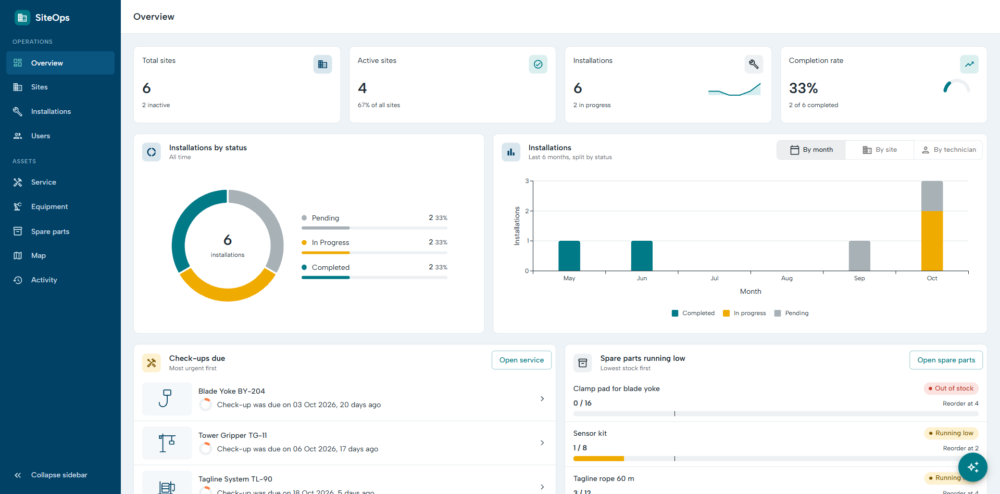

### Sites
Count tiles with icons that filter the list, site cards (or a table) with status chips and installation counts, and the search bar with its filter menu.

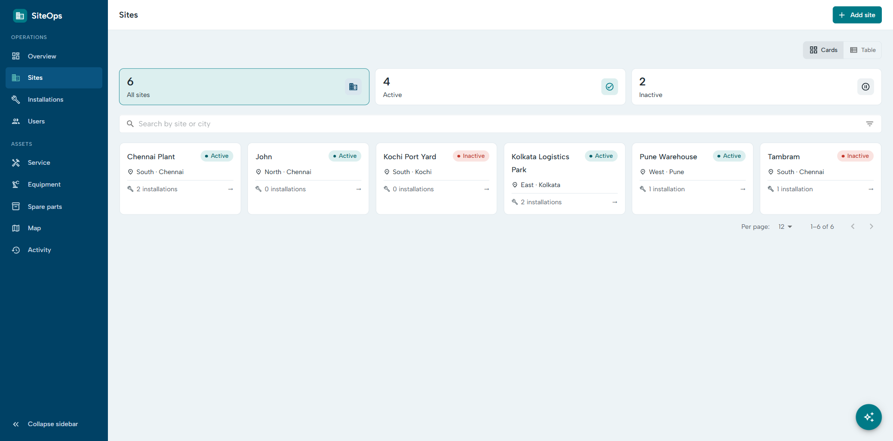

### Machines
A count per machine type, then each machine with its picture, status, site and next check-up.

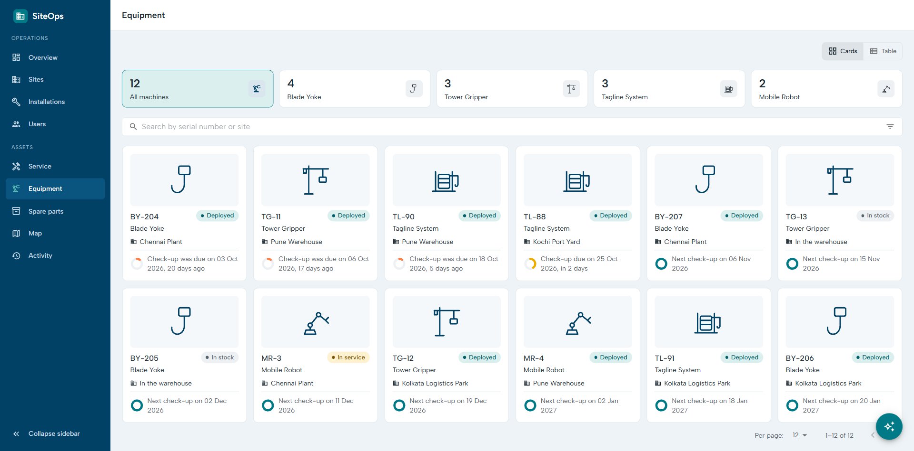

### Service
Check-ups grouped into Needs service now, Coming up this week and Later, each machine opening from its row, with Mark as done.

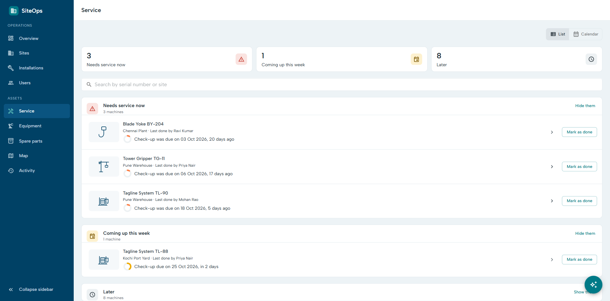

### Spare parts
Stock levels with a part icon, a stock meter showing the count and the reorder level, and Reorder for parts running low.

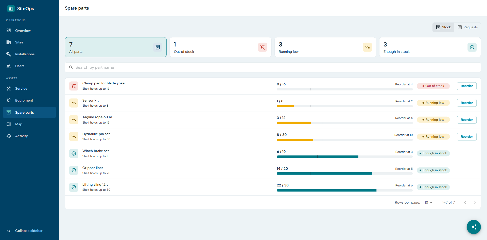

### Map
Every site on a map beside a list, coloured by status.

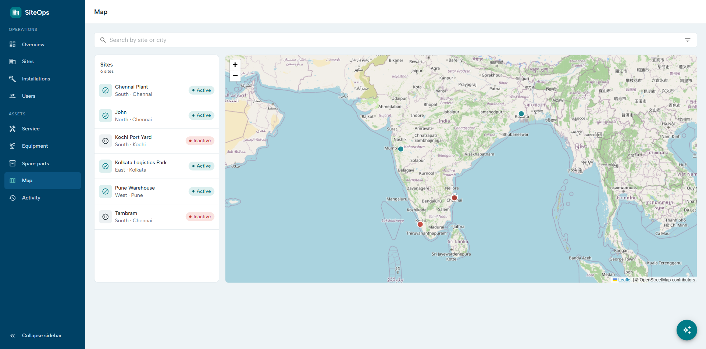

### Activity
Who changed what, as a timeline with an icon for each kind of change.

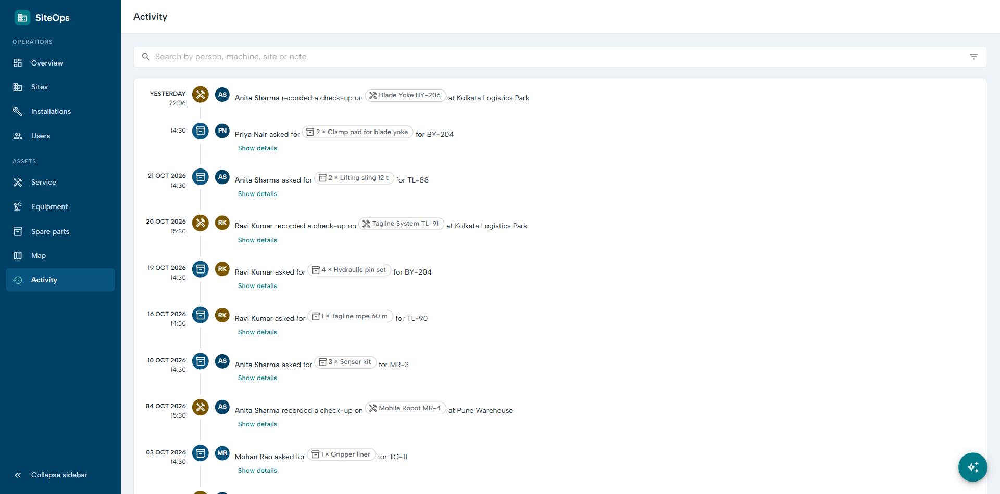

### Ask SiteOps
The AI assistant in full screen on the live site: saved chats on the left, an answer with a machine card and Mark as done, where the answer came from, and the input with its hint and counter.

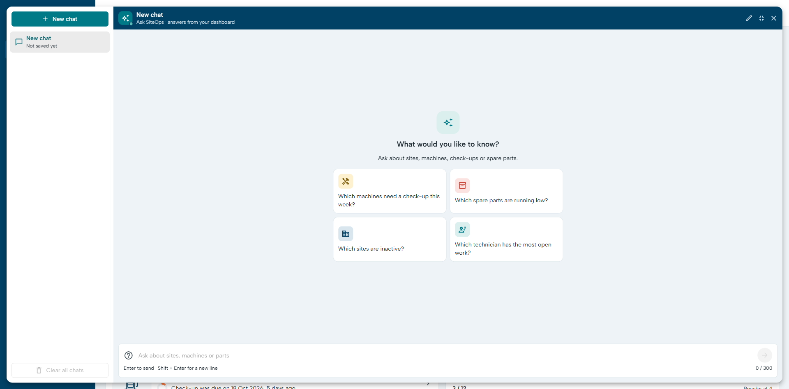

### Start-up card
Shown while the free tier wakes the server: Server, Database and Assistant, each waking, waiting or ready, with a timer and progress bar. The page opens by itself when the server answers.

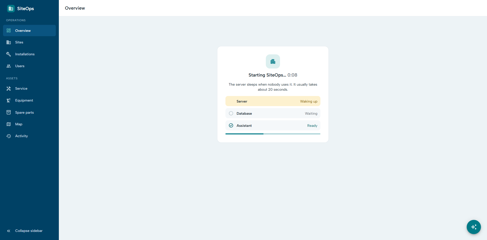

### Add site
Every field starts with the same icon as its table column.

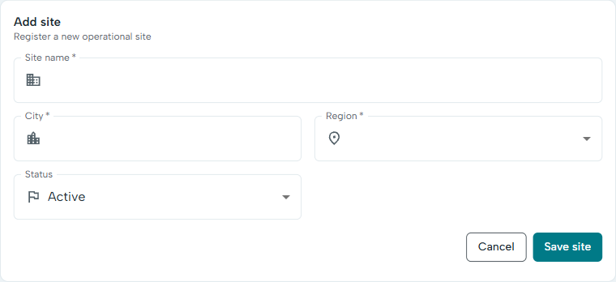

### Delete a site with installations
The dialog says how many installation records will also be deleted and how many machines will move to In stock, offers Edit site instead for marking the site inactive, and keeps Delete disabled until the site name is typed.

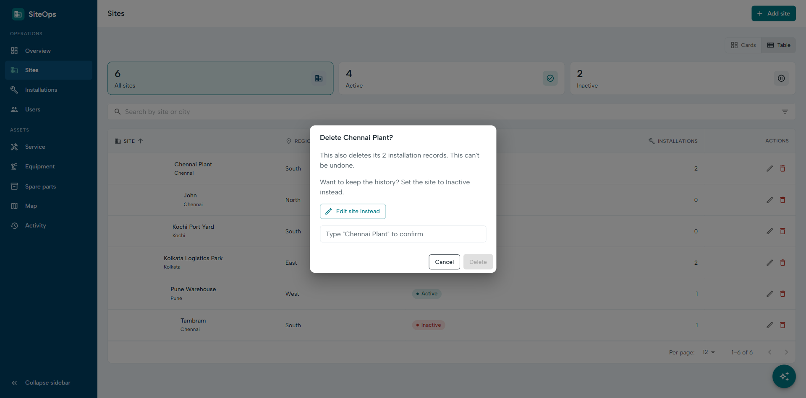

### Azure resources
The App Service plan and the API in Southeast Asia, and the Static Web App for the frontend, all in the `rg-siteops` resource group. The AI service web app, `siteops-dashboard-fj-ai`, was added to the same plan after this screenshot was taken.

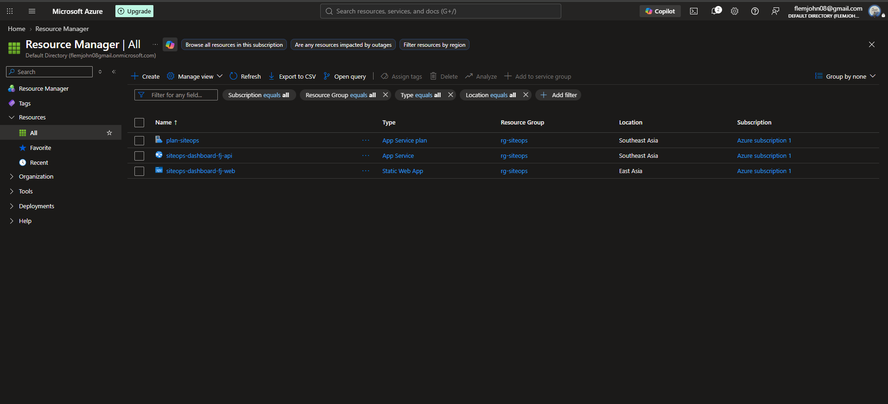

### Azure log stream
Production logs from the API: one JSON line per request with its request id, method, URL, status code and response time.

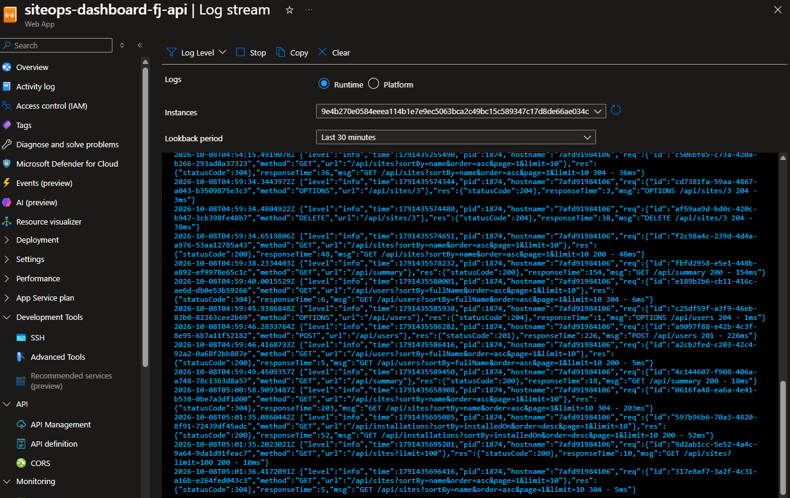

## Features

- **Overview dashboard** with summary cards (a sparkline and a completion gauge), an installations-by-status donut chart, an installations chart that switches between month, site and technician, and the latest installations
- **Sites**: list, search by name or city, filter by status and region, add, edit and delete; deleting a site warns how many installations go with it and moves its machines to In stock
- **Installations**: list, search by equipment or technician, filter by site and status, add, edit and delete
- **Users**: list, search by name or email, filter by role, add admins and technicians with an optional phone number
- **Machines**: cards or a table with a count per type; each machine page shows its drawing, site, next check-up, check-up history and parts asked for
- **Service**: check-ups grouped into Needs service now, Coming up this week and Later, as a list or a month calendar, with Mark as done
- **Spare parts**: stock levels with a reorder mark and Reorder, and a requests board (Requested, Ordered, Delivered)
- **Map**: sites on a map beside a list, with search and filters
- **Activity**: who changed what, as a timeline grouped by day with an icon per kind of change, and filters for kind, person and time
- **Ask SiteOps**: an AI assistant in a chat window that can be resized by dragging or opened full screen. It answers from the dashboard's data, shows machines and low parts as cards (five at most, with See all), and turns "TL-88 was serviced today by Ravi" into a filled-in form that only the person can save. Chats are saved with their memory: start a new chat, pick an old one up later, rename it, delete it, or clear them all, each behind a warning
- **Start-up card** while the free tier wakes the server, showing Server, Database and Assistant with a timer, and a waking banner in the chat while the assistant starts
- **Filter menu** inside the search bar, with the active filters shown as removable chips
- **Type-to-filter fields** (MUI Autocomplete) for site and technician in the installation form and the site filter
- **Icons** in every table header and form field, and an empty state with a Clear filters button
- **Server-side pagination** with a selectable page size
- **Server-side sorting** by clicking a column header
- **Validation** in the browser and on the server, with errors shown under each form field
- **Safe retries**: create requests carry an `Idempotency-Key`, so a repeated submit never creates a duplicate
- **Rate limits and security headers** on the API, with a tighter limit for AI questions
- **Structured logging** with a request id on every log line and response
- **Responsive layout** with a sidebar on desktop and a slide-in menu on mobile

## Tech stack

| Layer | Technology |
|---|---|
| Frontend | React 19, Vite, React Router 7, Material UI 9, MUI X Charts, MUI X Chat, MUI Lab (Timeline), Leaflet, re-resizable, Zod |
| Backend | Node.js 20+, Express 5, `pg`, Zod, Pino, Helmet, express-rate-limit |
| AI service | Python 3.12, FastAPI, OpenAI Agents SDK, gpt-4o on Azure OpenAI, Pydantic |
| Database | PostgreSQL hosted on Supabase |
| Hosting | Azure Static Web Apps (frontend), Azure App Service (backend and AI service) |

## Requirements coverage

| Requirement | Implementation |
|---|---|
| **Frontend:** responsive dashboard with summary cards | Overview page with four summary cards and two charts; layout adapts from desktop sidebar to mobile menu |
| **Frontend:** site listing page, search, filtering | Sites page with debounced search, status and region filters, server-side pagination |
| **Frontend:** form-based data entry | Add and edit forms for sites and installations with field-level validation |
| **Frontend:** React Hooks and REST API integration | `useState`, `useEffect`, `useCallback` plus custom hooks (`usePaginatedList`, `useEntityForm`, `useDeleteConfirmation`, `useFlashMessage`) calling the API through a single `fetch` client |
| **Backend:** REST CRUD for sites and installations | `GET`, `POST`, `PUT`, `DELETE` on `/api/sites` and `/api/installations` |
| **Backend:** validation | Zod schemas for every body, query string and route parameter |
| **Backend:** error handling | One central error handler, consistent `{ message, errors }` responses, PostgreSQL error codes mapped to 400 / 409 |
| **Backend:** logging | Pino with one line per request, level by status code, request ids, redacted secrets |
| **Database:** normalized `Sites`, `Installations`, `Users` tables | Third normal form with foreign keys, check constraints and delete rules |
| **Database:** joins, aggregations, optimized queries | Joins across all three tables, `WITH` queries, `COUNT ... FILTER`, window functions, `generate_series`; indexes on every filtered, sorted and joined column, index-friendly date ranges, SQL-side pagination and aggregation, parallel queries. See [Query optimization](docs/database.md#query-optimization) |
| **Azure:** deployment with environment variables | Frontend on Static Web Apps, backend and AI service on one App Service plan (F1); all configuration through environment variables |
| **API:** GET/POST for sites and installations plus a summary endpoint | `/api/sites`, `/api/installations`, `/api/summary` |
| **Beyond the brief:** machines, check-ups, spare parts, map, activity and an AI assistant | Pages, endpoints and tables listed below; the assistant is described in [docs/ai.md](docs/ai.md) |
| **Source control:** Git and README | This repository and README; commits follow the Conventional Commits style |

## Client-server architecture

The application is split into parts that each do one job and talk over the network:

- The **client** shows things and asks for things.
- The **server** checks things and decides.
- The **database** stores things.
- The **AI service** answers questions by reading through the server.

The browser never talks to the database or the AI service directly. Every request goes through the server.

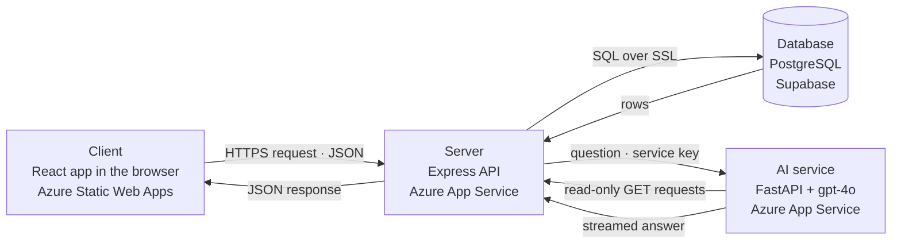

### Client: show and ask

- Draws the pages: Overview, Sites, Installations, Users, Machines, Service, Spare parts, Map, Activity and the forms
- Remembers what is on screen: current page, search text, form values
- Checks forms for instant feedback, such as "Enter a site name."
- Sends requests, such as "give me page 2 of the sites"
- Shows the answer as tables, charts and messages
- Never stores data, runs SQL or sees the database password

### Server: check and decide

- Validates every request again; this is the check that counts, because a request can bypass the browser
- Applies the business rules, such as unique site names and existing sites
- Runs the SQL to read or change data
- Returns JSON, or an error with a clear message
- Logs every request
- Is the only part allowed to connect to the database

### Database: store and protect

- Holds the `users`, `sites` and `installations` tables, and the asset tables `equipment`, `service_records`, `spare_parts`, `part_requests` and `activity_log`
- Enforces required fields, unique site names and valid statuses
- Enforces relationships, such as deleting a site's installations with the site
- Accepts encrypted connections from the server only

### AI service: read and suggest

- Receives questions from the server only, with a shared service key
- Lets gpt-4o pick from 11 tools: 8 read data through the server's `GET` endpoints, 3 fill in a form
- Never connects to the database and never saves; a form it fills in is saved by the person, through the normal endpoints
- Streams the answer back as JSON lines: the steps, the text, one card or form, and links to the records it used

How it works, the tools, the guardrails and the tested attacks are in [docs/ai.md](docs/ai.md).

### How the client and server talk

They exchange HTTP requests and JSON following REST. The URL names the resource, the method names the action and the status code reports the result.

```
Client:  GET  /api/sites?page=2&search=pune
Server:  200  { "data": [...], "pagination": {...} }

Client:  POST /api/sites  { "name": "Surat DC", "city": "Surat", "region": "West" }
Server:  201  { "id": 13, "name": "Surat DC", ... }
Server:  409  { "message": "A site with this name already exists." }
```

| Method | Action |
|---|---|
| GET | Read |
| POST | Create |
| PUT | Update |
| DELETE | Delete |

| Status | Meaning |
|---|---|
| 2xx | Success |
| 4xx | Problem with the request, such as invalid data or a missing record |
| 5xx | Problem on the server |

### Why it is split this way

| Benefit | In this project |
|---|---|
| Security | The database password lives only on the server; the browser cannot see it or run SQL |
| One source of truth | Every rule lives on the server, so any future client, such as a mobile app, follows the same rules |
| Separate deployment | The frontend and backend are deployed and updated independently |
| Scaling | The server keeps no memory between requests, so Azure can run several copies of it |
| Clear responsibilities | Frontend and backend work do not overlap, so each side is easier to understand and test |

### One action from start to finish

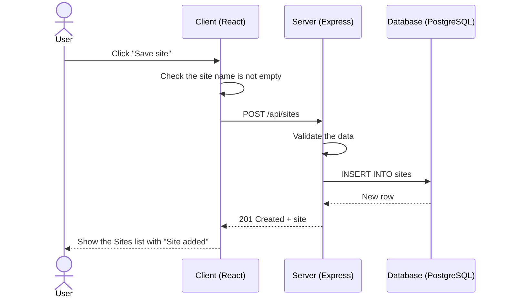

If the site name already exists, the database rejects the insert, the server returns `409` with "A site with this name already exists.", and the client shows that message under the Site name field.

The inner layers of the client and server are described in [docs/backend.md](docs/backend.md).

## Local project setup

Set up the parts in this order: database, backend, frontend, then the AI service if you want Ask SiteOps.

### Prerequisites

| Tool | Version | Check |
|---|---|---|
| Node.js | 20.11 or later | `node -v` |
| npm | Included with Node.js | `npm -v` |
| PostgreSQL | 14 or later, installed locally or a Supabase project | `psql --version` |
| Git | Any recent version | `git --version` |
| Python | 3.12, only for the AI service | `py -3.12 --version` |

Get the code:

```bash
git clone <repository-url>
cd site-operation-dashboard
```

### 1. Database setup

Create an empty database. The backend creates the tables in the next part.

**Option A: local PostgreSQL**

```bash
psql -U postgres -c "CREATE DATABASE site_operations;"
```

Connection string: `postgresql://postgres:<password>@localhost:5432/site_operations`

**Option B: Supabase**

1. Create a Supabase project.
2. In **Connect**, copy the **Session pooler** connection string.
3. In **Database Settings → SSL Configuration**, download the CA certificate and save it as `backend/certs/supabase-ca.crt`.

### 2. Backend setup

**Install dependencies**

```bash
cd backend
npm install
```

**Create the environment file**

```bash
cp .env.example .env
```

On Windows PowerShell use `Copy-Item .env.example .env`.

Edit `backend/.env` for a local PostgreSQL database:

```
NODE_ENV=development
PORT=5000
DATABASE_URL=postgresql://postgres:<password>@localhost:5432/site_operations
DATABASE_SSL=false
CORS_ORIGIN=http://localhost:5173
LOG_LEVEL=info
```

Or for Supabase:

```
NODE_ENV=development
PORT=5000
DATABASE_URL=postgresql://postgres.<project-ref>:<password>@aws-0-<region>.pooler.supabase.com:5432/postgres
DATABASE_SSL=true
DATABASE_SSL_CA=certs/supabase-ca.crt
CORS_ORIGIN=http://localhost:5173
LOG_LEVEL=info
```

| Variable | Description |
|---|---|
| `NODE_ENV` | `development` prints readable, coloured logs |
| `PORT` | API port; the frontend expects `5000` |
| `DATABASE_URL` | PostgreSQL connection string |
| `DATABASE_SSL` | `false` for local PostgreSQL, `true` for Supabase |
| `DATABASE_SSL_CA` | Path to the CA certificate, required when `DATABASE_SSL` is `true` |
| `CORS_ORIGIN` | The frontend URL, `http://localhost:5173` |
| `LOG_LEVEL` | `debug`, `info`, `warn` or `error` |
| `AI_SERVICE_URL` | Optional. The AI service address, `http://localhost:8000`. Without it, Ask SiteOps replies that it is not set up |
| `AI_SERVICE_KEY` | Required with `AI_SERVICE_URL`. A long random secret, the same value as in `ai/.env` |

**Create the tables and sample data**

```bash
npm run db:migrate
npm run db:seed
npm run db:seed:assets
```

`db:seed` empties the tables and loads 5 users, 5 sites and 5 installations, so never run it against a database with real data. `db:seed:assets` adds sample machines, check-ups, spare parts, part requests and activity, and leaves existing rows alone.

**Start the API**

```bash
npm run dev
```

The terminal shows:

```
INFO: Database connected
INFO: Server listening on port 5000
```

Open `http://localhost:5000/api/health`. It returns `{ "status": "ok", "database": "connected" }`.

Leave this terminal running.

### 3. Frontend setup

In a second terminal, from the project root:

**Install dependencies**

```bash
cd frontend
npm install
```

**Start the app**

```bash
npm run dev
```

Open `http://localhost:5173`. The Overview page shows the summary cards and charts from the sample data.

For the map, copy `frontend/.env.example` to `frontend/.env` and set `VITE_MAP_TILE_KEY` to a free CARTO Basemaps key (request one at https://carto.com/basemaps; it arrives by email). Without it the map shows "API key required". Leave `VITE_API_URL` empty locally: Vite forwards every `/api` request to `http://localhost:5000`. It is only set for deployment, where it points to the deployed API.

### 4. AI service setup (optional)

In a third terminal, from the project root. Python 3.12 is needed; 3.11.0 has a `typing` bug that stops `openai-agents` from importing.

```bash
cd ai
py -3.12 -m venv .venv
.venv\Scripts\pip install -r requirements-dev.txt
copy .env.example .env
```

Edit `ai/.env`:

| Variable | Description |
|---|---|
| `AZURE_OPENAI_API_KEY` | Key of the Azure OpenAI resource |
| `AZURE_OPENAI_ENDPOINT` | Resource endpoint, such as `https://<resource>.cognitiveservices.azure.com/` |
| `AZURE_OPENAI_DEPLOYMENT_NAME` | Model deployment name, `gpt-4o` |
| `BACKEND_API_URL` | `http://localhost:5000` |
| `AI_SERVICE_KEY` | The same secret as `AI_SERVICE_KEY` in `backend/.env` |

The optional settings are listed in [docs/ai.md](docs/ai.md#settings).

**Start the service**

```bash
.venv\Scripts\python -m uvicorn --app-dir src siteops_ai.main:app --port 8000
```

Add `AI_SERVICE_URL=http://localhost:8000` and the same `AI_SERVICE_KEY` to `backend/.env`, then restart the backend. The round button at the bottom right of every page opens Ask SiteOps.

### Troubleshooting

| Problem | Cause | Fix |
|---|---|---|
| `Invalid environment configuration` when the backend starts | A variable in `backend/.env` is missing or invalid | The message names the variable; add or correct it |
| `DATABASE_SSL_CA: Required when DATABASE_SSL is true` | SSL is on without a certificate | Set `DATABASE_SSL=false` for local PostgreSQL, or add the Supabase certificate |
| `Cannot connect to the database` with `ECONNREFUSED` | PostgreSQL is not running, or the host or port is wrong | Start PostgreSQL and check `DATABASE_URL` |
| `password authentication failed` | Wrong user or password in `DATABASE_URL` | Correct the credentials |
| `database "site_operations" does not exist` | The database was not created | Run the database setup step |
| `relation "sites" does not exist` | The tables were not created | Run `npm run db:migrate` in `backend` |
| `EADDRINUSE` on port 5000 | Another program uses the port | Stop that program, or change `PORT` and the proxy target in `frontend/vite.config.js` |
| The app shows "Cannot reach the server" | The backend is not running | Start it with `npm run dev` in `backend` |
| Empty tables and charts | No sample data | Run `npm run db:seed` in `backend` on a new database |
| Empty Machines, Service or Spare parts pages | No asset data | Run `npm run db:seed:assets` in `backend` |
| Ask SiteOps says it is not set up | `AI_SERVICE_URL` is missing from `backend/.env` | Set it and `AI_SERVICE_KEY`, then restart the backend |
| Ask SiteOps says it couldn't get an answer | The AI service is not running, or the two `AI_SERVICE_KEY` values differ | Start the AI service and make both keys the same |
| `TypeError` from `typing` when the AI service starts | Python 3.11.0 | Rebuild `ai/.venv` with Python 3.12 |

## Scripts

| Folder | Command | Description |
|---|---|---|
| `backend` | `npm run dev` | Start the API with automatic restart |
| `backend` | `npm start` | Start the API in production mode |
| `backend` | `npm run db:migrate` | Run `database/migrations` in order; safe to run again |
| `backend` | `npm run db:seed` | Empty the tables and load sample data |
| `backend` | `npm run db:seed:assets` | Add sample machines, check-ups, parts, requests and activity; leaves existing rows alone |
| `frontend` | `npm run dev` | Start the Vite development server |
| `frontend` | `npm run build` | Build the production bundle into `frontend/dist` |
| `frontend` | `npm run preview` | Serve the production build locally |
| `ai` | `.venv\Scripts\python -m uvicorn --app-dir src siteops_ai.main:app --port 8000` | Start the AI service |
| `ai` | `.venv\Scripts\python -m pytest` | Run the AI service tests |
| `ai` | `.venv\Scripts\ruff check src tests` | Lint the AI service |

## API

All endpoints are under `/api` and use JSON.

| Method | Endpoint | Description |
|---|---|---|
| GET | `/health` | API and database status |
| GET | `/summary` | Totals, status breakdown, monthly counts, recent installations |
| GET | `/sites` | Paginated list with `search`, `status`, `region`, `sortBy`, `order` |
| GET | `/sites/counts` | Counts for the summary strip, with the same filters |
| GET | `/sites/:id` | One site |
| POST | `/sites` | Create a site |
| PUT | `/sites/:id` | Update a site |
| DELETE | `/sites/:id` | Delete a site and its installations; its machines move to In stock |
| GET | `/installations` | Paginated list with `search`, `siteId`, `status`, `sortBy`, `order` |
| GET | `/installations/counts` | Counts for the summary strip, with the same filters |
| GET | `/installations/:id` | One installation |
| POST | `/installations` | Create an installation |
| PUT | `/installations/:id` | Update an installation |
| DELETE | `/installations/:id` | Delete an installation |
| GET | `/users` | Paginated list with `search`, `role`, `sortBy`, `order` |
| GET | `/users/counts` | Counts for the summary strip, with the same filters |
| POST | `/users` | Create a user (`Idempotency-Key` supported) |
| GET | `/equipment` | Paginated machines with `search`, `type`, `status`, check-up `state`, `siteId`, `dueFrom`, `dueTo` |
| GET | `/equipment/counts` | Counts per type and check-up state, with the same filters |
| GET | `/equipment/:id` | One machine with its check-ups and part requests |
| POST | `/equipment/:id/service-records` | Record a finished check-up (`Idempotency-Key` supported) |
| GET | `/spare-parts` | Parts with their stock level, filtered by `stockLevel` |
| GET | `/spare-parts/counts` | Counts per stock level |
| GET | `/part-requests` | Requests filtered by `status` |
| POST | `/part-requests` | Ask for a part (`Idempotency-Key` supported) |
| PATCH | `/part-requests/:id` | Move a request to its next status |
| GET | `/activity` | Recent changes with `search`, `kind`, `actor` and `days` |
| GET | `/activity/people` | People who appear in the activity |
| GET | `/assistant/status` | Whether the AI service is `ready`, `waking`, `down` or `off`; wakes it if it is asleep |
| POST | `/assistant` | Ask SiteOps a question in a new or saved chat; the answer streams back as JSON lines and is saved |
| GET | `/chat-sessions` | This browser's saved chats |
| GET | `/chat-sessions/:id/messages` | One chat's messages |
| PATCH | `/chat-sessions/:id` | Rename a chat |
| DELETE | `/chat-sessions/:id` | Delete one chat |
| DELETE | `/chat-sessions` | Delete all of this browser's chats |

Paginated responses:

```json
{
  "data": [],
  "pagination": { "page": 1, "limit": 10, "total": 5, "totalPages": 1 }
}
```

Error responses:

```json
{ "message": "Please fix the highlighted fields.", "errors": { "name": "Enter a site name." } }
```

Full request and response examples, validation rules, error codes, idempotency and logging are in [docs/backend.md](docs/backend.md).

## Database

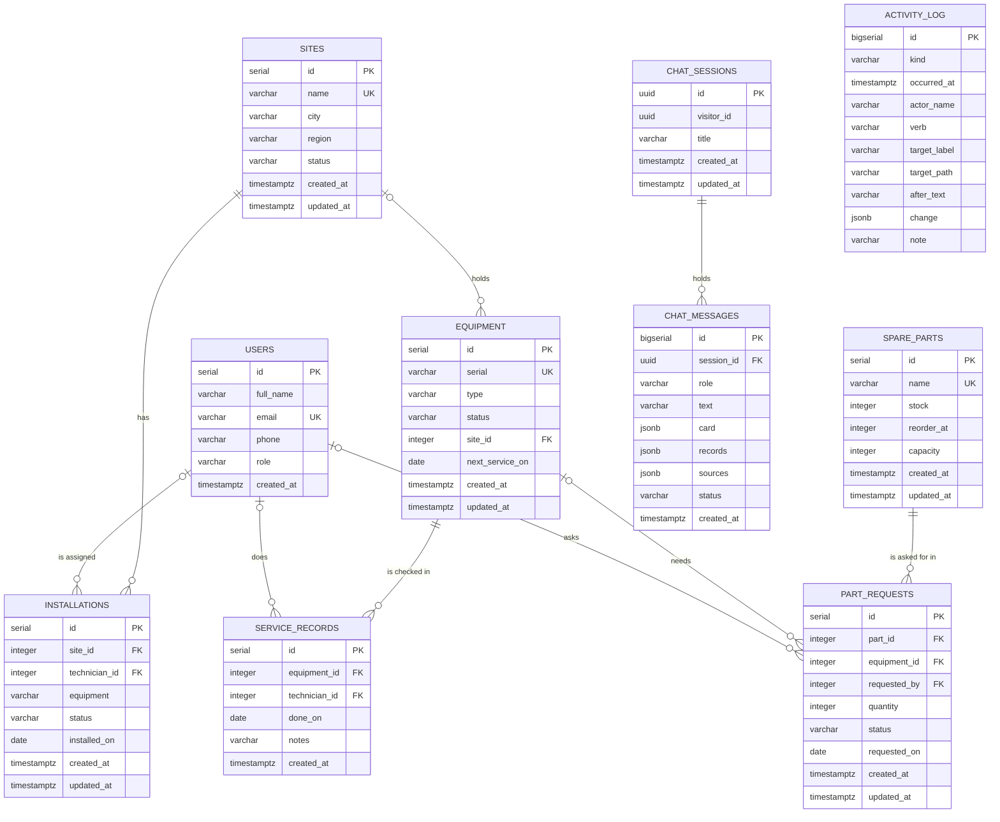

| Relationship | Type |
|---|---|
| `sites` → `installations` | One-to-many, required. Deleting a site deletes its installations. |
| `users` → `installations` | One-to-many, optional. Deleting a user keeps the installations as unassigned. |
| `sites` ↔ `users` | Many-to-many through `installations` |
| `sites` → `equipment` | One-to-many, optional. Deleting a site moves its machines to In stock, in the warehouse, so none is left Deployed with no site. |
| `equipment` → `service_records` | One-to-many, required. A machine with check-ups cannot be deleted. |
| `users` → `service_records` | One-to-many, optional. Deleting a technician keeps the check-ups without a name. |
| `spare_parts` → `part_requests` | One-to-many, required. A part with requests cannot be deleted. |
| `equipment` → `part_requests` | One-to-many, optional. A request can be for the shelf rather than a machine. |
| `users` → `part_requests` | One-to-many, optional. Deleting a user keeps the requests without a name. |
| `activity_log` | No foreign keys, so the history stays after a record is deleted. When a site is deleted, its entries link to the Sites list instead of the deleted page. |
| `chat_sessions` → `chat_messages` | One-to-many, required. Deleting a chat deletes its messages. Each chat belongs to one browser through `visitor_id`. |

Example queries demonstrating joins and aggregations are in `database/queries`. Column rules, constraints, the `idempotency_keys` table and normalization notes are in [docs/database.md](docs/database.md).

## Deployment on Azure

The application is deployed with the Azure CLI:

| Part | Azure service |
|---|---|
| Frontend | Azure Static Web Apps (Free) |
| Backend | Azure App Service, Linux, Node.js |
| AI service | Azure App Service, Linux, Python 3.12, on the same plan as the backend |
| Model | Azure OpenAI, gpt-4o |
| Database | Supabase PostgreSQL (not on Azure) |

All configuration is passed through environment variables: App Service application settings for the backend and the AI service, and `VITE_API_URL` and `VITE_MAP_TILE_KEY` at build time for the frontend.

Outline:

```powershell
az login
az group create --name rg-siteops --location southeastasia
az appservice plan create --name plan-siteops --resource-group rg-siteops --is-linux --sku F1
az webapp create --name <api-name> --resource-group rg-siteops --plan plan-siteops --runtime "NODE:24-lts"
az staticwebapp create --name <web-name> --resource-group rg-siteops --location eastasia --sku Free
az webapp config appsettings set --name <api-name> --resource-group rg-siteops --settings NODE_ENV=production ...
az webapp deploy --name <api-name> --resource-group rg-siteops --src-path backend.zip --type zip
az webapp create --name <ai-name> --resource-group rg-siteops --plan plan-siteops --runtime "PYTHON:3.12"
az webapp deploy --name <ai-name> --resource-group rg-siteops --src-path ai.zip --type zip
npx @azure/static-web-apps-cli deploy ./dist --deployment-token <token> --env production
```

Step-by-step instructions, every setting, verification, updates, monitoring, cost and troubleshooting are in [docs/deployment.md](docs/deployment.md).
