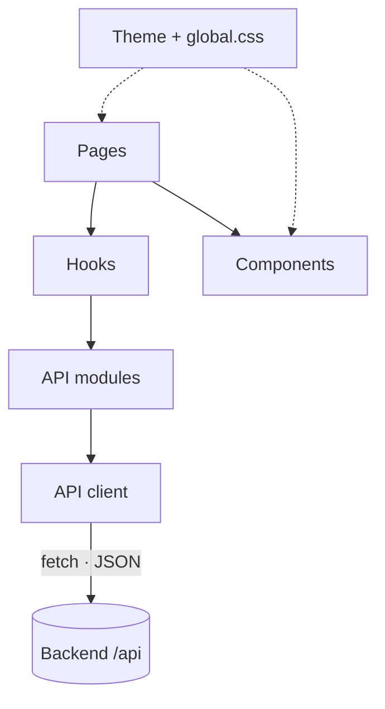
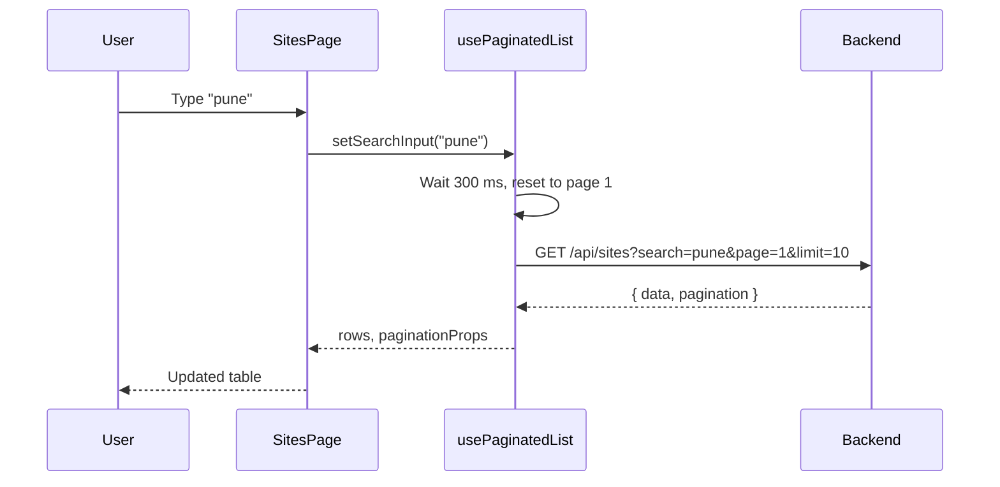
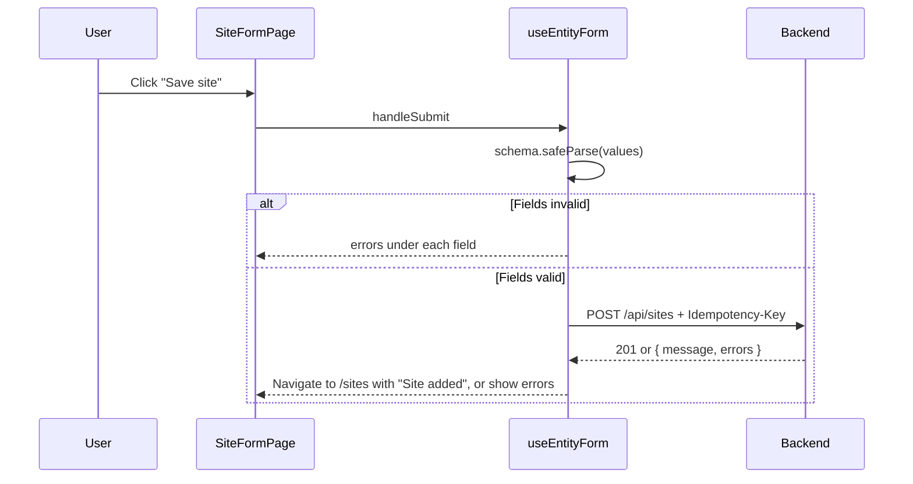

# Frontend

The frontend is a React single-page application built with Vite and Material UI. It shows the dashboard, lets users search, filter and edit sites and installations, and talks to the backend only through the REST API.

Ask SiteOps answers questions with gpt-4o through the Python AI service, which reads the same data as the pages through read-only tools. See [Ask SiteOps](#ask-siteops) and [ai.md](ai.md).

## Stack

| Concern | Library | Purpose |
|---|---|---|
| UI library | `react` 19 | Components and hooks |
| Build tool | `vite` | Development server, `/api` proxy and production build |
| Routing | `react-router-dom` 7 | Page URLs, links and navigation |
| Components | `@mui/material` 9 | Layout, tables, forms, dialogs, alerts |
| Icons | `@mui/icons-material` | Material SVG icons |
| Charts | `@mui/x-charts` | Donut, stacked bar, sparkline and gauge on the Overview page |
| Styling engine | `@emotion/react`, `@emotion/styled` | Required by Material UI |
| Validation | `zod` 4 | Form schemas that mirror the backend's |
| Map | `leaflet`, `react-leaflet` 5 | Site map with OpenStreetMap tiles |

HTTP requests use the browser's built-in `fetch`; no extra HTTP library is needed.

## Folder structure

```
frontend/
├── index.html                    HTML entry, loads Albert Sans
├── vite.config.js                React plugin and /api proxy to localhost:5000
├── .env.example                  VITE_API_URL for deployed builds
├── public/
│   ├── favicon.svg
│   └── staticwebapp.config.json  Azure Static Web Apps route fallback
└── src/
    ├── main.jsx                  Theme, CSS baseline and router
    ├── App.jsx                   Routes, each page loaded on demand
    ├── constants.js              Statuses, regions, colours, page sizes
    ├── utils.js                  Date, percentage and option helpers
    ├── fieldIcons.js             One icon per field, shared by table headers and form fields
    ├── activityKindIcons.js      One icon per kind of activity
    ├── api/                      One module per resource and a shared client
    ├── lib/                      Small pure helpers: dates, sorting, paging, text
    ├── hooks/                    Reusable state logic
    ├── validation/               Zod form schemas mirroring backend/src/validators
    ├── components/               Reusable UI pieces
    ├── pages/                    One component per screen
    └── styles/
        ├── theme.css             Colour and font tokens, the only place colours are written
        ├── colors.js             Reads the tokens for Material UI and the charts
        ├── theme.js              Material UI palette, typography and component overrides
        ├── global.css            Imports the stylesheets below
        └── layout.css, lists.css, cards.css, forms.css, detail.css, overview.css,
            empty-state.css, equipment.css, service.css, spare-parts.css,
            activity.css, map.css, assistant.css, assistant-shell.css,
            assistant-cards.css                    One stylesheet per area
```

## Architecture



| Layer | Folder | Responsibility | Knows about |
|---|---|---|---|
| Pages | `src/pages` | Compose a screen from hooks and components | Hooks, components |
| Components | `src/components` | Display data and raise events | Props only |
| Hooks | `src/hooks` | Hold state, load data, handle forms and dialogs | API modules |
| API modules | `src/api` | One function per endpoint | API client |
| API client | `src/api/client.js` | Build the URL, send the request, turn failures into messages | `fetch` |

Components never call the API, and the API layer never touches the UI. Each layer can be read and changed on its own.

## Routes

| URL | Page | Purpose |
|---|---|---|
| `/` | `OverviewPage` | Summary cards, status donut chart, installations chart by month, site or technician, recent installations |
| `/sites` | `SitesPage` | Sites as cards or a table, with a clickable summary strip, search, filters, pagination and delete |
| `/sites/:id` | `SiteDetailPage` | One site: status, region and city, installation counts by status, its installations, Edit, Delete and Add installation here |
| `/sites/new` | `SiteFormPage` | Create a site |
| `/sites/:id/edit` | `SiteFormPage` | Edit a site |
| `/installations` | `InstallationsPage` | Installation list with search, site and status filters, pagination, delete |
| `/installations/new` | `InstallationFormPage` | Create an installation |
| `/installations/:id/edit` | `InstallationFormPage` | Edit an installation |
| `/users` | `UsersPage` | User list with search, role filter, sorting and pagination |
| `/users/new` | `UserFormPage` | Create a user |
| `/service` | `ServicePage` | Check-ups grouped into Needs service now, Coming up this week and Later, as a list or a month calendar, with Mark as done |
| `/equipment` | `EquipmentPage` | Machines as cards or a table, with a count per type, search, filters and pagination |
| `/equipment/:id` | `EquipmentDetailPage` | One machine: drawing, site, next check-up, check-up history, parts asked for, history and Mark check-up as done |
| `/spare-parts` | `SparePartsPage` | Stock levels with a reorder mark and Reorder, or the requests board (Requested, Ordered, Delivered) |
| `/map` | `MapPage` | Sites on a map beside a list, with search and filters |
| `/activity` | `ActivityPage` | Who changed what, grouped by day, with search and filters for kind, person and time |
| any other URL | `NotFoundPage` | "Page not found" with a link back |

Every page is loaded with `React.lazy`, so the browser downloads a page's code, including the chart library, only when that page is opened.

## Pages

| Page | Uses | Shows |
|---|---|---|
| `OverviewPage` | `getSummary`, `StatCard`, `StatusDonutCard`, `InstallationBreakdownCard`, `InstallationTable` | Four stat cards (installations with a sparkline, completion rate with a gauge), installations by status, installations by month, site or technician, the five latest installations |
| `SitesPage` | `usePaginatedList`, `useDeleteConfirmation`, `useFlashMessage`, `SiteTable` | Searchable, filterable, sortable, paginated sites with edit and delete |
| `SiteFormPage` | `useEntityForm` | Name, city, region and status fields |
| `InstallationsPage` | `usePaginatedList`, `useDeleteConfirmation`, `useFlashMessage`, `InstallationTable` | Searchable, filterable, sortable, paginated installations with edit and delete |
| `InstallationFormPage` | `useEntityForm`, `OptionAutocomplete`, `getSites`, `getTechnicians` | Equipment, site, technician, date and status fields. Site and Technician are type-to-filter fields; clearing Technician means unassigned. The Site list offers active sites only, plus the current site when editing an installation at an inactive one |
| `UsersPage` | `usePaginatedList`, `useFlashMessage`, `UserTable` | Searchable, filterable, sortable, paginated users |
| `UserFormPage` | `useEntityForm` | Full name, email, phone and role fields |
| `ServicePage` | `useListCounts`, `useDebouncedValue`, `ServiceGroup`, `ServiceCalendar`, `MarkDoneDialog` | Machines due a check-up, most urgent first. Each group asks the server for its own state, 8 at a time, with Show more. Later is folded away. The calendar asks only for the month it shows |
| `EquipmentPage` | `usePaginatedList`, `useListCounts`, `EquipmentCard`, `EquipmentTable` | Machines by type, with the next check-up on every card and row |
| `EquipmentDetailPage` | `useRecord`, `EquipmentDetailHeader`, `ServiceHistoryCard`, `PartRequestListCard`, `HistoryCard` | One machine and everything done to it |
| `SparePartsPage` | `StockPanel`, `PartRequestsPanel` | Stock or Requests, picked with a toggle that is remembered |
| `MapPage` | `usePaginatedList`, `SiteMap`, `MapSiteList` | Real sites placed by city. Picking one in the list flies the map to it and opens its popup with Open site |
| `ActivityPage` | `usePaginatedList`, `ListToolbar`, `ActivityList` | 20 events a page, grouped under Today, Yesterday or the date |
| `NotFoundPage` | — | Message and a link to the Overview |

## Components

| Component | Purpose | Used by |
|---|---|---|
| `Layout` | Sidebar `Drawer` (fixed on desktop, slide-in on mobile), top `AppBar` with the page title and Add button, page area | Every page |
| `SidebarNav` | Brand, page links in two groups (Operations and Assets) and, on desktop, a Collapse sidebar button. Based on MUI's mini variant drawer: collapsed, the sidebar shrinks from 232px to 64px, labels fade out and each icon shows its page name as a tooltip. The choice is saved in `localStorage`. Phones keep the slide-in menu | `Layout` |
| `SiteTable` | Sites table with sortable headers, status chips, installation counts, edit and delete buttons | Sites page |
| `UserTable` | Users table with sortable headers, phone and role chips | Users page |
| `TableHeaderCell` | Header cell with the column's icon and, when `onSort` and `column` are passed, a `TableSortLabel` arrow | All tables |
| `EmptyTableRow` | `EmptyState` inside a table row | All tables |
| `EmptyState` | `EmptyIllustration`, a message and an optional action such as Clear filters | Tables, card grids |
| `EmptyIllustration` | Small crate drawing coloured from the tokens | `EmptyState` |
| `PageIntro` | One sentence under the page title saying what the page is for | List pages |
| `SummaryStrip` / `SummaryTile` | Row of counts; a tile can apply its filter when clicked | Sites, Users, Site detail |
| `ViewToggle` | Cards or Table switch | Sites, Users |
| `CardGrid` | Responsive grid of cards, or `EmptyState` when there are none | Sites, Users |
| `SiteCard` / `UserCard` | One site or one person as a card; a site card opens its detail page | Sites, Users |
| `PersonAvatar` | Initials in a coloured circle; the colour is picked from the name | `UserCard` |
| `StatusTabs` | Tabs with a count each | Installations |
| `SiteDetailHeader` | Back link, name, status, region and city, Edit and Delete | Site detail |
| `ListPagination` | `TablePagination` with the shared settings | All lists |
| `FieldIcon` | Icon at the start of a form field (`InputAdornment`); turns blue while the field is focused | All forms and the filter menu |
| `OptionAutocomplete` | MUI `Autocomplete` for `{ value, label }` options. Shows the label, returns the value, and returns `''` when cleared | Installation form, Site filter |
| `StatCard` | Summary card with label, icon, value, an optional small chart and a note | Overview |
| `StatusDonutCard` | Donut chart of installations by status with a legend and percentage bars | Overview |
| `InstallationBreakdownCard` | One stacked `BarChart` with a `ToggleButtonGroup`: by month (vertical bars) or by site or technician (horizontal bars, busiest first). Both axes have titles (Month, Site or Technician, and Installations); axis sizes are set to `'auto'` so MUI measures the labels and titles never overlap them. The three toggle buttons share one width and show an icon with their name, or only the icon on narrow screens. The chart keeps the same height in every view | Overview |
| `CardIcon` | The rounded icon tile used in stat cards and in the chart and table card headers | Overview |
| `InstallationTable` | Installations table; edit and delete buttons appear only when `onDelete` is passed, sortable headers only when `onSort` is passed | Overview, Installations page |
| `StatusChip` | Coloured status label | Both tables |
| `ListToolbar` | Search bar with a filter button inside it. The button opens a `Popover` of filters, shows a `Badge` with the number of active filters, and each active filter appears as a removable `Chip` under the bar. "Clear all" resets the filters and keeps the search text | All list pages |
| `SearchField` | Text field with a search icon and an optional button at the end | `ListToolbar` |
| `FilterSelect` | Dropdown with an "All …" option and a field icon. Filters marked `searchable` use `OptionAutocomplete` instead | `ListToolbar` |
| `DeleteDialog` | Confirmation dialog with a deleting state and an inline error. With `confirmText`, Delete stays disabled until that exact text is typed | Both list pages |
| `SiteDeleteDialog` | Site wording for `DeleteDialog`. A site with no installations gets a plain confirmation. A site with installations says how many records will also be deleted, links to Edit so the site can be set to Inactive instead, and asks for the site name before Delete is enabled | Sites page |
| `SuccessSnackbar` | Green confirmation message at the bottom of the screen | Both list pages |
| `ErrorAlert` | Red message with optional Retry and Back buttons | Overview, list pages, form pages |
| `ErrorBoundary` | Replaces a crashed page with a recovery message instead of a blank screen | `Layout` |

### Assets components

| Component | Purpose | Used by |
|---|---|---|
| `EquipmentDrawing` | Picks `BladeYokeDrawing`, `TowerGripperDrawing`, `TaglineSystemDrawing` or `MobileRobotDrawing`. Each is a small inline SVG whose parts are coloured by CSS classes from the tokens | Equipment, Service |
| `HealthRing` / `ServiceDueLine` | A ring that empties as a check-up gets closer, with the due date in words, such as "Check-up was due on 03 Oct 2026, 19 days ago" | Equipment, Service, Overview |
| `EquipmentCard` / `EquipmentTable` | One machine as a card or a table row | Equipment |
| `EquipmentDetailHeader` | Drawing, name, status, site link, next check-up and an action button | Machine page |
| `ServiceHistoryCard` / `PartRequestListCard` | Check-ups done and parts asked for on one machine | Machine page |
| `ServiceItem` / `ServiceGroup` | One machine due a check-up; a titled group of them that can be folded | Service |
| `ServiceCalendar` | Month grid with each machine on its due date, coloured by urgency, with Previous, Next and This month | Service |
| `MarkDoneDialog` | `MarkDoneForm` in a dialog: date, technician and notes; shows the next check-up date before saving | Service, Machine page |
| `TechnicianSelect` | Dropdown of technicians | Check-up and reorder dialogs |
| `StockPanel` / `StockLevelRow` / `StockBar` | Parts with a bar to the shelf capacity, a line at the reorder level and Reorder when low | Spare parts, Overview |
| `ReorderDialog` | `ReorderForm` in a dialog: how many and who asked | Spare parts |
| `PartRequestsPanel` / `RequestBoard` / `RequestColumn` / `RequestCard` | Three columns of requests; a card moves forward with Mark as ordered or Mark as delivered. Each column shows 8 and then Show more | Spare parts |
| `ServiceDueCard` / `LowStockCard` | The four most urgent check-ups and the four lowest parts | Overview |
| `SiteMap` / `MapFocus` / `MapSiteList` | Leaflet map with a circle per site (teal active, red inactive), fitted to the sites shown, and the list beside it | Map |
| `ActivityList` / `ActivityRow` / `ActivityChange` | Events grouped by day: time, avatar with a kind badge, a sentence with a link, and Show details for the change and note | Activity, `HistoryCard` |
| `HistoryCard` | The activity for one site or machine, five at a time | Site page, Machine page |

### Ask SiteOps components

| Component | Purpose |
|---|---|
| `AskSiteOps` | Round button at the bottom right of every page, with a dot when an answer arrived while the window was closed. Opens the window |
| `AssistantWindow` | Our header (Full screen, Close) above MUI X Chat's `ChatBox`, which draws the chat list, the conversation, suggestions and the composer. Close keeps everything. Full screen on phones. Escape leaves full screen first, then closes |
| `ChatHistoryPanel` | The chat list: New chat, the saved chats with a ⋯ menu each, and Clear all chats |
| `ChatRowMenu` | Rename and Delete for one chat |
| `RenameChatDialog`, `DeleteChatDialog`, `ClearChatsDialog`, `ChatHistoryDialogs` | The warnings: deleting one chat asks once; clearing all says how many messages go and needs DELETE typed |
| `ChatAvatar` | The Ask SiteOps mark beside each answer |
| `ChatStepPart`, `ChatRecordsPart`, `ChatErrorPart` | Drawn inside an answer: each lookup with a spinner or tick, the record chips with Where this came from, and a red error line |
| `AssistantShell` | Places the window: resizable from the left edge, top edge and top-left corner (360×480 up to 90% of the screen, 400×620 by default, remembered), or filling the screen |
| `ResizeGrip` | A resize handle that also works from the keyboard: arrow keys resize in 20 px steps, Home or a double-click resets |
| `AssistantCard` | Checks a `ui` card against its schema in `assistant/cardRegistry.js` and draws it; draws nothing if the card is unknown or wrong |
| `MachineCardsCard` | Up to five machines with their drawing and due date, Mark as done on each, and See all |
| `StockRowsCard` | Up to five low parts as stock rows with Reorder, and See all |
| `MarkServiceDoneCard`, `ReorderPartCard`, `ConfirmMoveCard` | Forms filled in from the message. Nothing is saved until the person presses the button |
| `ChatSavedNote` | What was saved, with a link to the record |
| `SeeAllLink` | "Showing 5 of 12" with a link to the full page |
| `AssistantSources` | Where this came from: what each lookup checked, in plain words |

## Hooks

| Hook | Holds | Returns |
|---|---|---|
| `usePaginatedList(fetchList, initialFilters, initialSort)` | Search text, filters, sort column and direction, page, page size, rows, loading and error state | `rows`, `filters`, `searchInput`, `setSearchInput`, `updateFilter`, `clearFilters` (only while a search or filter is active), `paginationProps`, `sortProps`, `reload`, `refreshAfterDelete` |
| `useEntityForm(options)` | Form values, field errors, load and submit state, the idempotency key | `values`, `errors`, `isEditing`, `isLoading`, `loadError`, `submitError`, `isSubmitting`, `setFieldValue`, `handleChange`, `handleSubmit` |
| `useDeleteConfirmation({ deleteRequest, onDeleted })` | The item being deleted, deleting state, error | `item`, `open`, `dialogProps` |
| `useFlashMessage()` | A success message passed from another page | `message`, `showMessage`, `clearMessage` |
| `useStoredFlag(key)` | A true/false value kept in `localStorage`; falls back to `false` when storage is unavailable | `[value, toggle]` |
| `useStoredChoice(key)` | A text value kept in `localStorage` | `[choice, setChoice]` |
| `useListView(key, total)` | Cards or Table; defaults to Table when there are more than 50 records | `[view, setView]` |
| `useListCounts(fetchList, queries, params, version)` | Totals for several filters at once, each read from the API's `pagination.total` with `limit=1` | `{ name: count }` |
| `useRecord(load, id)` | One record by id | `record`, `error`, `isLoading`, `reload` |
| `useSiteOptions()` | Sites for the Site filter | `options`, `error` |
| `useLoader(load, initialData)` | Anything loaded in one request, such as the check-ups due or the part requests | `data`, `isLoading`, `error`, `reload` |
| `useTechnicians()` | Technicians for the dialogs | `technicians`, `error` |
| `useLoadMore(fetchList, params, pageSize)` | One server list that grows a page at a time; starts again when `params` change | `items`, `total`, `isLoading`, `error`, `hasMore`, `loadMore` |
| `useDebouncedValue(value)` | The value 300 ms after it stops changing | The settled value |
| `useChatSessions()` | The saved chats, the open chat, and new, rename, delete and clear all | `conversations`, `savedConversations`, `activeId`, `selectChat`, `startNewChat`, `renameChat`, `deleteChat`, `clearAllChats` |
| `useChatHistoryActions(chat, showMessage)` | Which warning is open, and running the action behind it | `startRename`, `startDelete`, `startClear`, `confirmDelete`, `confirmClear` |
| `useAssistantSize()` | The chat window size, kept between 360×480 and 90% of the screen and remembered in the browser | `size`, `saveSize`, `resetSize` |

The hooks return ready-made props for Material UI components, so connecting them takes one line:

```jsx
<TablePagination component="div" {...sites.paginationProps} />
<SiteTable sites={sites.rows} onDelete={deletion.open} {...sites.sortProps} />
<SiteDeleteDialog site={deletion.item} {...deletion.dialogProps} />
```

## Data flow

### Lists



- Search waits 300 ms after the last keystroke, so typing a word sends one request instead of one per letter.
- Changing search, a filter or the page size returns to page 1.
- Responses that arrive after a newer request has started are ignored, so a slow old response never replaces newer results.
- Pagination, search and filtering run on the server; the browser only holds the current page.

### Forms



- Each form is checked with a Zod schema before sending, for instant feedback. The schema also trims text and turns dropdown values into the types the API expects, such as `"3"` into `3` and an empty technician into `null`.
- Errors returned by the server appear under the matching field.
- Each form creates one `Idempotency-Key` when it opens and sends it with every submit, so a repeated click or retry never creates a duplicate.
- After saving, the form returns to the list and the list shows "Site added" or "Installation updated".

## Asset data

The Assets pages read the API like every other page:

| Module | Endpoints |
|---|---|
| `equipmentApi` | `GET /equipment`, `GET /equipment/:id` |
| `serviceApi` | `GET /equipment` sorted by next check-up, `POST /equipment/:id/service-records` with an `Idempotency-Key` |
| `sparePartsApi` | `GET /spare-parts`, `GET /part-requests`, `POST /part-requests` with an `Idempotency-Key`, `PATCH /part-requests/:id` |
| `activityApi` | `GET /activity`, `GET /activity/people` |

| Behaviour | Detail |
|---|---|
| Saving once | `MarkDoneForm` and `ReorderForm` (in their dialogs and in chat) make one key when they open, so a double click or a retry saves one record |
| Moving a request | The card sends the status it should move to. If someone else moved it first, the board shows the message and reloads |
| Paging | The Service groups and the request columns load 8 at a time from the server; lists use page numbers |
| Errors | Dialogs show the server's field message, such as "The check-up date cannot be in the future." |

### Ask SiteOps

Ask SiteOps uses MUI X Chat (`@mui/x-chat` 9.0.0-alpha.19, pinned because it is still an alpha). `assistant/createAssistantAdapter.js` connects it to our API: `listMessages` loads a saved chat, and `sendMessage` calls `askAssistant({ sessionId, question })`, which posts to `/api/assistant` with the browser's `X-Visitor-Id` through `streamRequest`. `assistant/createChunkMapper.js` turns each line into MUI chunks: steps become tool parts, text becomes text deltas, and the card, record links and errors become `data-card`, `data-records` and `data-error` parts drawn by `assistant/buildPartRenderers.jsx`. Each line is one event:

| Event | Meaning |
|---|---|
| `session` | The chat's id and title, so a new chat moves into the list when the answer finishes |
| `thinking` | The question was received |
| `step` | A lookup started; the one before it finished |
| `text` | The next part of the answer |
| `ui` | One card or form to draw under the answer |
| `done` | The answer is complete, with its record links and sources |
| `error` | The answer stopped; the message is shown in red in its place |

`useChatSessions` holds the chat list and the open chat. A new chat has a `draft-` id and shows as "New chat" at the top of the list until its first answer finishes; then it opens under its saved id. The server keeps the memory, so a follow-up such as "who did the last check-up on it?" knows what "it" is, even days later. `useChatHistoryActions` runs rename, delete and clear all behind their warnings. The window's code is loaded only when it is first opened, and it stays mounted while closed, so an answer can finish in the background and light the dot on the button. If the stream ends without `done` or `error`, the answer is marked "stopped before it finished".

## API layer

`src/api/client.js` is the only place that calls `fetch`.

| Behaviour | Detail |
|---|---|
| Base URL | `VITE_API_URL` + `/api`. Locally `VITE_API_URL` is empty and Vite forwards `/api` to `http://localhost:5000` |
| Query strings | Built from an object; empty values are left out |
| Headers | `Content-Type: application/json` when there is a body, `Idempotency-Key` on create requests |
| Timeout | 15 seconds |
| Empty responses | `204 No Content` returns `null` |
| Errors | Every failure becomes an `ApiError` with `message`, `status` and field `errors` |

| Failure | Message shown |
|---|---|
| No connection | Cannot reach the server. Check your connection and try again. |
| No response within 15 seconds | The server is taking too long to respond. Please try again. |
| Field errors from the server | Please fix the highlighted fields. |
| 503 | The service is temporarily unavailable. Please try again shortly. |
| Other 5xx | Something went wrong. Please try again. (Reference: first 8 characters of `X-Request-Id`) |
| Other 4xx | The server's message, such as "A site with this name already exists." |

The reference code matches the `X-Request-Id` in the backend log, so a reported error can be found in the logs.

## Validation

| File | Checks | Mirrors |
|---|---|---|
| `validation/siteSchema.js` | Name and city required and length-limited, region and status from the allowed lists | `backend/src/validators/siteSchemas.js` |
| `validation/installationSchema.js` | Equipment required, site required, technician optional, `YYYY-MM-DD` date, status from the allowed list | `backend/src/validators/installationSchemas.js` |
| `validation/assistantCardSchema.js` and one schema per card | A `ui` card's name, total, See all path and props, before it is drawn | `ai/src/siteops_ai/schemas/card.py` and the tools |
| `validation/commonSchemas.js` | Shared rules (`requiredText`, `positiveId`, `optionalId`) and `toFieldErrors`, which turns Zod issues into `{ field: message }` | `backend/src/validators/commonSchemas.js` |

The frontend and backend use the same Zod version, the same rules and the same messages, kept as two copies so each side builds and deploys on its own. When a rule or message changes, change both. The browser check gives instant feedback; the server check is the one that counts, because any request can bypass the browser. Checks that need the database, such as a duplicate site name, happen only on the server and appear under the matching field.

## Error handling

| Situation | Where it appears |
|---|---|
| Overview fails to load | `ErrorAlert` with Retry instead of the page |
| A list fails to load | `ErrorAlert` with Retry above the table |
| Site options for the installation filter fail to load | Yellow warning above the table |
| A form field is invalid | Red text under the field |
| Saving fails | `ErrorAlert` at the top of the form |
| An edit page cannot load its record | `ErrorAlert` with a Back button |
| Deleting fails | Error inside the delete dialog, which stays open |
| A component crashes while rendering | `ErrorBoundary` shows Reload and Back to overview; the sidebar keeps working |
| Unknown URL | `NotFoundPage` |

## Styling

Colours and the font live in one file, and components use no inline styles or `sx` props.

| File | Contains |
|---|---|
| `styles/theme.css` | Every colour and the font as CSS variables, based on the ENABL palette (Stormfront Blue sidebar, Evergreen Tide actions, Solar Glow for in progress). Font: Aptos where installed, otherwise Albert Sans |
| `styles/colors.js` | Reads the tokens at start-up so Material UI and the charts use the same values |
| `styles/theme.js` | Palette, typography and `styleOverrides` for Material UI components: the sidebar, outlined cards, uppercase table headers, tinted status chips, rounded inputs and buttons |
| `styles/global.css` | Imports one stylesheet per area: `layout.css`, `lists.css`, `cards.css`, `forms.css`, `detail.css`, `overview.css`, `empty-state.css`, `equipment.css`, `service.css`, `spare-parts.css`, `activity.css`, `map.css`, `assistant.css`, `assistant-shell.css` and `assistant-cards.css`. All colours come from the tokens |

`main.jsx` wraps the app in `StyledEngineProvider injectFirst`, so Material UI's styles load first and the area stylesheets can adjust them without `!important`.

Material UI 9 removed shortcut style props such as `flexGrow`, `fontWeight`, `alignItems` and `justifyContent` from `Typography` and `Stack`; they are ignored without an error. Use a class in the area stylesheet instead.

### Colours

| Token | Value | Used for |
|---|---|---|
| `sidebar` | `#004165` | Sidebar background, machine drawings |
| `primary` | `#007a87` | Buttons, links, charts, Active, Completed |
| `page` | `#edf3f6` | Page background |
| `border` | `#dbe4e9` | Card and table borders |
| `warning` | `#f0ab00` | In Progress, check-ups due this week, low stock |
| `highlight` | `#ff7f45` | Late check-ups |
| `danger` | `#c4372b` | Inactive, out of stock, errors |
| `pending` | `#a7b1b6` | Pending |
| `muted` | `#56636b` | Secondary text |

### Responsive layout

| Width | Behaviour |
|---|---|
| 900 px and wider | Fixed sidebar, four stat cards per row, charts side by side |
| Below 900 px | Sidebar becomes a slide-in menu opened from the top bar |
| Below 900 px | The map list moves under the map and the requests board becomes one column |
| Below 600 px | Stat cards and form fields stack in one column; tables scroll sideways; Ask SiteOps opens full screen |

## Configuration

| Variable | When | Purpose |
|---|---|---|
| `VITE_API_URL` | Production builds only | Backend address without `/api`, for example `https://siteops-dashboard-fj-api.azurewebsites.net`. Vite writes it into the build, so the frontend is rebuilt when it changes |

Locally no `.env` file is needed: `vite.config.js` forwards `/api` to `http://localhost:5000`.

## Scripts

Run from the `frontend` folder.

| Command | Description |
|---|---|
| `npm run dev` | Start the development server at `http://localhost:5173` |
| `npm run build` | Build the production bundle into `dist` |
| `npm run preview` | Serve the production build locally |

## Deployment

The production build is deployed to Azure Static Web Apps. `public/staticwebapp.config.json` sends every route to `index.html`, so refreshing a page such as `/sites/3/edit` works. Build and deployment commands are in [deployment.md](deployment.md).
